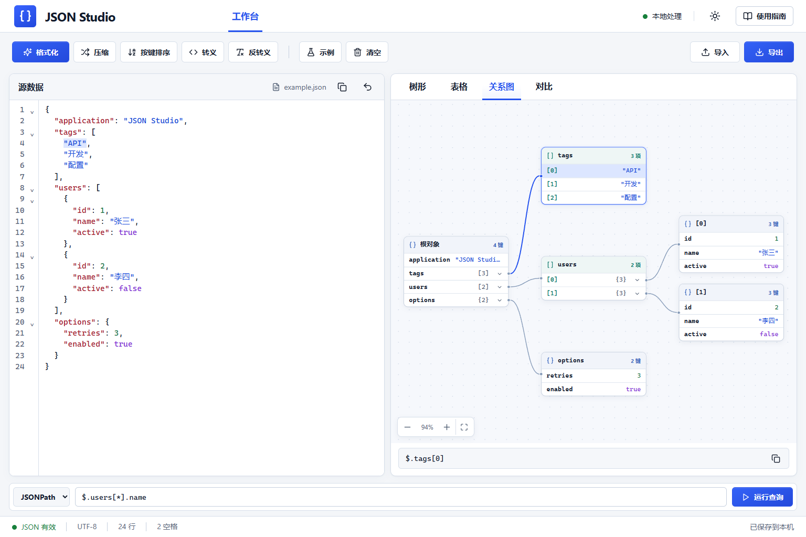

# JSON Studio

一个在浏览器中运行的中文 JSON 工作台，适合查看接口响应、调试配置文件和比较两份 JSON。使用 React、TypeScript 和 Vite 构建。



## 功能

- **编辑与校验** 支持格式化、压缩、按键排序、转义和反转义。点击语法错误提示可跳到对应位置。
- **结构浏览** 提供树形、表格和关系图。关系图将数组项按索引放在同一张卡片中，用曲线连接嵌套结构。选中字段可定位源码并复制路径。
- **查询与对比** 在 Web Worker 中执行 JSONPath 或 jq。可按结构比较 JSON，也可逐行查看文本差异。
- **文件与本地保存** 支持导入和导出 JSON、CSV，自动在当前浏览器保存草稿和主题。

## 本地启动

需要 Node.js 22.12 或以上版本。

```sh
npm ci
npm run dev
```

打开终端显示的本地地址，默认是 `http://127.0.0.1:5173`。运行 `npm run build` 生成 `dist/`，运行 `npm run preview` 预览构建结果。

构建使用 Rollup 的官方 WebAssembly 版本，兼容限制加载原生 Node 模块的 Windows 环境。

## 代码结构

| 目录                     | 职责                                          |
| ------------------------ | --------------------------------------------- |
| `src/json/`              | 语法分析、转换、比较、文件编解码和查询 Worker |
| `src/editor/`            | CodeMirror 配置与源码编辑面板                 |
| `src/inspector/`         | 树形、表格、关系图及对比视图                  |
| `src/workspace/`         | 页面组合、操作协调、示例和本地保存            |
| `src/ui/`、`src/styles/` | 通用控件、主题和响应式布局                    |

数据在浏览器中处理。源数据和主题保存在当前浏览器的 `localStorage` 中。jq 引擎按需从站点自身加载，两种查询都在 Web Worker 中运行。结构对比按数组索引和对象键匹配。CSV 导入时保留字段的原始字符串，便于保留编号的前导零。

## 验证

```sh
npm run lint
npm test
npx playwright install chromium
npm run test:e2e
```

如果已经安装 Microsoft Edge，可在 PowerShell 中先设置 `$env:JSON_STUDIO_BROWSER_CHANNEL = 'msedge'`，然后运行 `npm run test:e2e`。

## 许可证

本项目采用 [MIT 许可证](LICENSE)。
